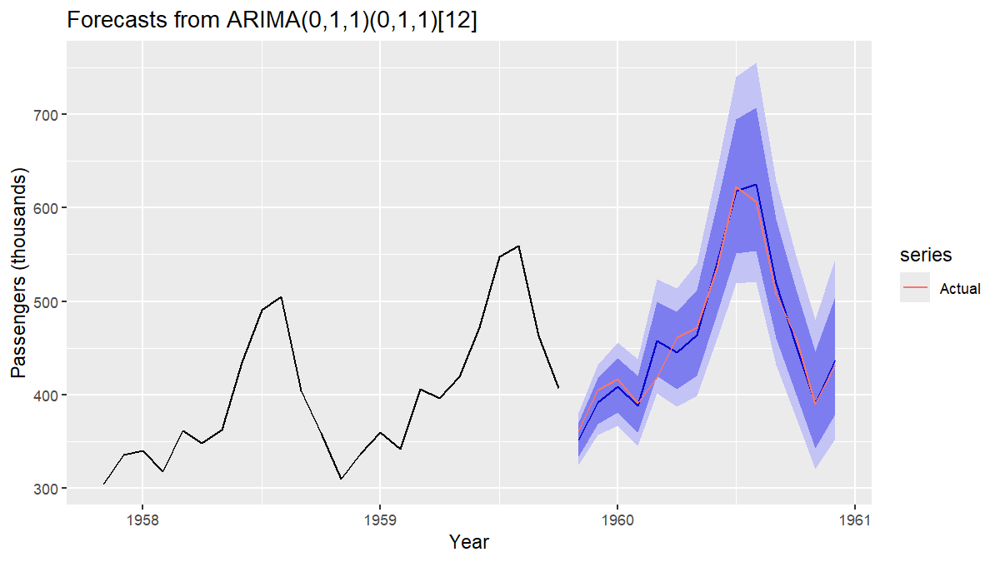
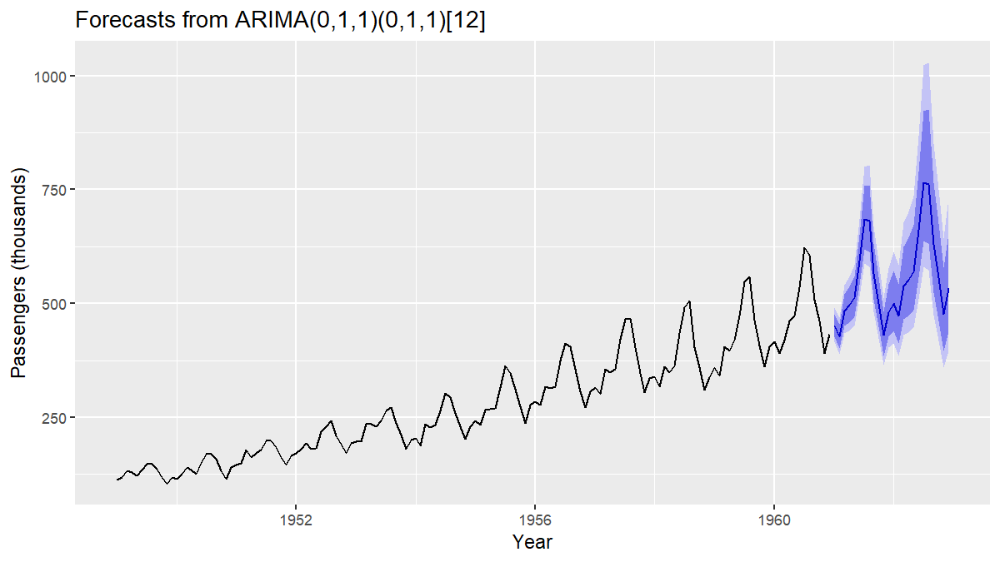

# AirPassengersAnalysis

Seasonal ARIMA forecasting of the classic monthly air passengers series
(1949-1960, thousands of passengers), compared against seasonal naive and ETS
baselines.

## Method

1. Multiplicative decomposition; log + regular + seasonal differencing to check stationarity.
2. Train/test split by date: train through Oct 1959 (130 obs), test Nov 1959 - Dec 1960 (14 obs).
3. `auto.arima` (D = 1) with a Box-Cox lambda estimated on the training data only.
4. Residual diagnostics, then holdout RMSE / MAE / MAPE against `snaive` and `ets`.
5. Expanding-window time series cross-validation on the training data
   (initial window 72, h = 12), reported as RMSE and MAE by horizon.
6. Refit on all data with the same specification and forecast 24 months ahead.

## Run

```r
install.packages(c("forecast", "ggplot2"))   # once
source("analysis.R", echo = TRUE)
```

`echo = TRUE` prints each step and its output to the Console. Figures and
`sessionInfo()` are written to `output/`. Developed with R 4.5.2,
forecast 9.0.2, ggplot2 4.0.3.

## Results

### Selected model

`auto.arima(train, D = 1, lambda = lamb)` selects the airline model,
ARIMA(0,1,1)(0,1,1)[12], with Box-Cox lambda = -0.193.

| Parameter | Estimate | s.e. |
|---|---|---|
| ma1  | -0.388 | 0.097 |
| sma1 | -0.596 | 0.079 |

AICc = -673.0. Residuals show no remaining autocorrelation
(Ljung-Box Q* = 22.3, df = 22, p = 0.44).

### Holdout accuracy (14 months)

| Model | RMSE | MAE | MAPE (%) |
|---|---|---|---|
| ARIMA  | 14.15 | 10.73 | 2.37 |
| ETS    | 29.79 | 25.10 | 5.15 |
| SNAIVE | 61.00 | 58.14 | 12.86 |



### Cross-validation error by horizon (training data only)

| Horizon (months) | 1 | 2 | 3 | 4 | 5 | 6 | 7 | 8 | 9 | 10 | 11 | 12 |
|---|---|---|---|---|---|---|---|---|---|---|---|---|
| ARIMA RMSE  | 10.2 | 12.4 | 14.7 | 16.8 | 17.4 | 18.5 | 19.9 | 21.4 | 22.0 | 23.6 | 24.1 | 25.1 |
| ARIMA MAE   | 8.0 | 9.4 | 10.8 | 12.0 | 12.4 | 13.8 | 14.2 | 15.4 | 15.8 | 17.7 | 18.6 | 19.7 |
| SNAIVE RMSE | 40.7 | 40.6 | 40.7 | 40.7 | 40.8 | 40.6 | 40.0 | 39.7 | 39.4 | 39.3 | 39.4 | 39.1 |
| SNAIVE MAE  | 37.1 | 37.0 | 37.1 | 37.0 | 37.0 | 36.7 | 36.2 | 35.9 | 35.5 | 35.3 | 35.3 | 35.0 |

The ARIMA model beats seasonal naive at every horizon.

### Final forecast

Refit on all 144 observations, 24 months ahead:



## Caveats

- The holdout is a single 14-month split, so it is noisy. The cross-validation
  figures are the more reliable estimate: ARIMA RMSE averages about 19 over
  h = 1..12, against 14.2 on the holdout.
- The cross-validation fixes the ARIMA order selected on the full training
  set, so model selection is not repeated inside each fold. This is mild
  here (the airline model is the standard choice for this series) but makes
  the CV figures slightly optimistic.
- Point forecasts are back-transformed without bias adjustment (medians, not
  means). With a residual variance of about 0.00017 on the transformed scale
  the difference is negligible.
- Differencing orders (d = 1, D = 1) are checked visually, not with formal tests.
- Strong performance on this series reflects how well-behaved it is
  (smooth multiplicative seasonality, stable trend) and says little about
  the pipeline on harder data.
